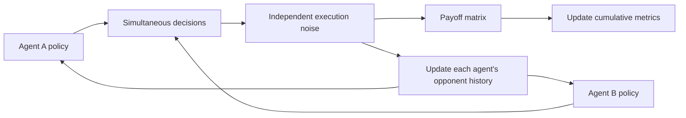

# Game Theory Simulator

**A reproducible C simulation of strategic decision-making in repeated Prisoner's Dilemma games.**

Play as a human, compare six rule-based computer agents, explore imperfect execution and randomized decisions, and export round-robin tournament data for further analysis. The project is written in ISO C11, with no third-party runtime dependencies.

[](https://github.com/MrDavidKaplan/game-theory-simulator/actions/workflows/ci.yml)


## Quick start

**Requirements:** A C11 compiler (`clang` or `gcc`) and `make`. Works on macOS and Linux.

```bash
make
./build/game-theory play --p1 copycat --p2 mostly-cheat --rounds 10
./build/game-theory vs-ai --p2 grudger --rounds 5
./build/game-theory human --rounds 5
./build/game-theory tournament --rounds 200 --matches 100 --seed 42 --csv results.csv
make test
```

The first command builds the CLI. You can simulate agents against each other (`play`), compete against a computer (`vs-ai`), play locally with another person (`human`), or compare all agents in a round-robin tournament (`tournament`). `make test` executes strategy, payoff, RNG reproducibility, and CLI smoke tests (including both interactive modes).

## The model

At each round, two agents independently choose **cooperate (C)** or **defect (D)**. Each agent sees its opponent's action only *after* both choices are resolved. Their rewards are assigned using this payoff matrix:

| Agent A / Agent B | Cooperate (C) | Defect (D) |
|---|---|---|
| **Cooperate (C)** | A: +2, B: +2 | A: -1, B: +3 |
| **Defect (D)** | A: +3, B: -1 | A: 0, B: 0 |

Repeated interaction lets agents condition their next choice on previous opponent behavior. The simulator deliberately separates **decision**, **execution noise**, **scoring**, and **observation** so agents cannot react to a current-round move they have not yet seen.

## Implemented strategies

| Strategy | Decision policy |
|---|---|
| `always-cooperate` | Cooperates every round. |
| `mostly-cheat` | Cooperates once, then defects in every subsequent round. |
| `joker` | Cooperates independently with probability `--joker-prob` (default `0.5`). |
| `copycat` | Cooperates initially, then repeats the opponent's previous action. |
| `grudger` | Cooperates until the opponent defects once; then defects permanently. |
| `copykitten` | Cooperates unless the opponent defected in each of the previous two rounds. |

Strategies are **rules**, not trained machine-learning models. "Joker" is randomized; the other five are deterministic in the absence of action noise.

## Example: head-to-head match

```bash
./build/game-theory play --p1 copycat --p2 mostly-cheat --rounds 10 --seed 42
```

```text
Match: copycat vs mostly-cheat
Rounds: 10 | Seed: 42 | Noise: 0.000 | Joker p: 0.500

Strategy              Total points   Points / round     Cooperation
copycat                          1            0.100           20.0%
mostly-cheat                     5            0.500           10.0%
```

The printed statistics are actual simulator output, not projected or hypothetical results.

## Example: full tournament

```bash
./build/game-theory tournament --rounds 200 --matches 100 --seed 42 \
  --csv results.csv
```

All **36 ordered matchups** (six agents vs. six agents, including self-play) are simulated. Every ordered pair is repeated 100 times, with 200 rounds per match: **720,000 simulated rounds** in total.

Each row in `results.csv` contains:

```text
strategy,opponent,mean_points_per_round,cooperation_rate
```

Both metrics refer to the **first** named strategy. The tournament averages results over the repeated matches for that ordered pair. Terminal output also includes the equally weighted mean across all six opponents. See [`examples/tournament.csv`](examples/tournament.csv) and [`examples/tournament.txt`](examples/tournament.txt) for a reproducible example.

> **Interpretation note:** Tournament rankings depend on the opponent population, game length, reward matrix, random seed, and noise level. They do not establish a universally optimal strategy.

## Experiment configuration

| Flag | Default | Purpose |
|---|---|---|
| `--rounds N` | `200` | Repeated interactions per match; maximum 100,000. |
| `--matches N` | `100` | Independent matches per ordered pairing, for tournaments. |
| `--seed N` | `42` | Reproducible 32-bit random seed. |
| `--noise X` | `0` | Probability that each intended action is independently flipped before scoring. |
| `--joker-prob X` | `0.5` | Probability that Joker *intends* cooperation. |
| `--p1 NAME` | `copycat` | First agent in `play`. |
| `--p2 NAME` | `grudger` | Second agent in `play`, or computer opponent in `vs-ai`. |
| `--csv PATH` | — | CSV output path for `tournament`. |

For example, compare outcomes under a 2% independent execution-error rate:

```bash
./build/game-theory tournament --rounds 500 --matches 100 \
  --noise 0.02 --seed 42 --csv results-noisy.csv
```

**Noise model:** An execution error changes the *actual* action. That changed action is used for both payoffs and the opponent's next-round memory. This distinguishes an intended decision from what the opponent observes.

**Reproducibility:** The simulator uses a small deterministic xorshift32 pseudorandom-number generator. Identical flags and seeds reproduce the same results on supported platforms. It is not suitable for cryptographic applications.

## Architecture



| Path | Responsibility |
|---|---|
| `include/game.h` | Public types and simulation API. |
| `src/game.c` | Policies, agent memory, random sampling, payoff calculation, match engine. |
| `src/main.c` | CLI parsing, human and computer play, match summaries, tournaments, CSV export. |
| `tests/test_game.c` | Assertions for all six policies, all payoff cases, determinism, and state reset. |
| `.github/workflows/ci.yml` | Automated GCC/Clang builds and tests on Linux and macOS. |
| `docs/model.md` | Mathematical formulation, assumptions, and limitations. |

## Validation

```bash
make test
```

The test suite checks all four payoff outcomes; opening moves and the state transitions of every strategy; Joker probabilities at 0 and 1; fixed-seed reproducibility; execution errors; and match-state isolation. GitHub Actions runs the same suite on each push or pull request.

## Scope and limitations

This is a discrete, complete-information, two-action repeated-game simulator with **fixed policies**. It does not implement reinforcement learning, evolutionary selection, financial forecasting, or strategic equilibrium solvers. Those would be distinct extensions. The default tournament assigns equal weight to every opponent and includes self-play; this is a modeling choice rather than a claim about real populations.

## Background

The simulation explores the repeated Prisoner's Dilemma, a classic setting for studying cooperation and retaliation. The strategy names are inspired by Nicky Case's interactive essay [*The Evolution of Trust*](https://ncase.me/trust/). This repository is a separate implementation focused on simulation, testability, and reproducible experiment design.

## License

Released under the [MIT License](LICENSE).
